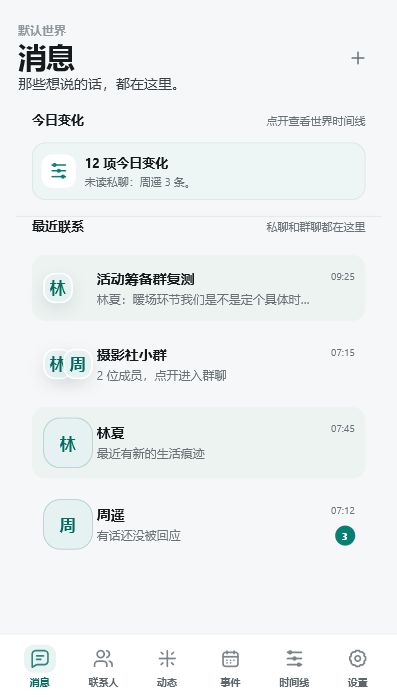
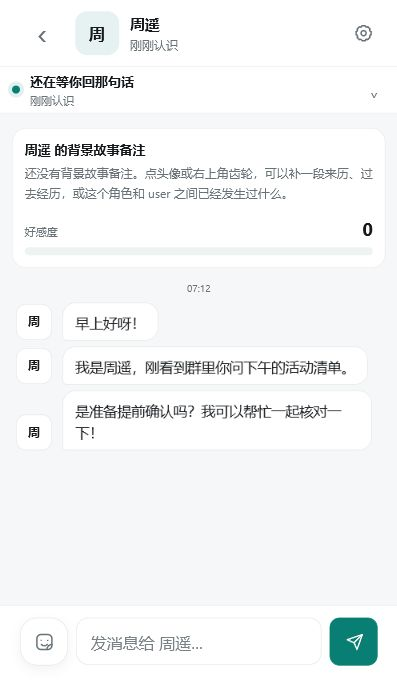

# PalTavern

PalTavern 是一个本地优先的角色社交与角色扮演应用。它读取 SillyTavern 角色卡（JSON，或带 `chara` / `ccv3` 文本块的 PNG），把角色放进你自己的世界里：私聊、群聊、动态、世界事件和长期记忆都保存在本机。模型不内置，需要自己填写 DeepSeek 或其它兼容 OpenAI Chat Completions 的接口。

当前版本是 `1.1.04`。应用可以在本地网页里运行，也可以用 Electron 做成 Windows 桌面窗口，或用 Capacitor 打成 Android 调试包。它不依赖 SillyTavern 页面一直开着，也没有账号和云同步。

## 功能

下面这些能力已经接在当前源码里。

- **五个主入口**：消息、角色、世界、动态、设置。
- **角色**：导入 SillyTavern JSON / PNG 角色卡，内置一张示例角色，也可以在写卡工具里新建。可导出 SillyTavern V3 JSON 角色卡。导出不含 API Key 和聊天记录。
- **世界**：多个世界的角色、私聊、群聊、动态、事件和记忆互相分开。可以填写用户人设，搜索城市，并用 Open-Meteo 刷新天气，作为模型上下文。
- **消息**：每个角色有独立私聊。可以切换通讯身份，用用户或某个角色的口吻发言。空会话会按角色设定生成一条私信式开场，而不是直接粘贴角色卡里的 `first_mes`。
- **群聊**：同一个世界里共享一份群聊记录。热闹程度可以选热闹、自然或安静。
- **动态**：发布动态、评论，角色也可以回复。
- **世界 RP**：世界页承接场景续写、事件和记忆。事件与时间线不再占底部导航。
- **记忆**：时间线、分层摘要、今日简报和角色状态写在本地，并可以进入后续模型上下文。
- **关系与主动消息**：每个角色有关系阶段、好感度和关系摘要。可以设置主动发消息的间隔、每日上限和安静时段。用户连续不回复时会降频；重新回复后由用户决定是否恢复原来的频率。错过的计划时间不会在下次打开时补发。
- **提示词**：自带私聊、群聊和世界预设，也可以导入带 `prompts` 的 SillyTavern 预设 JSON。
- **模型**：默认 DeepSeek。也可以填其它兼容 OpenAI Chat Completions 的地址。本地服务会代理 `/api/chat-completions` 和 `/api/models`。有每日请求预算。
- **数据**：聊天和设置写在浏览器 `localStorage` 的 `tavern-social-state-v1`。可以导出完整备份 JSON，也可以导出或导入单个世界包（`pal-tavern-world-bundle-v1`）。
- **表情包、通知、桌面托盘**：支持本地表情包。Electron 关闭窗口时会收到托盘，进程还在时调度器可以继续检查。Android 用 WorkManager 请求下一次检查，系统可以推迟或跳过，不能当成准时的即时通讯后台。

还没有这些能力：账号、云同步、iOS 客户端、内置大模型。

## 界面截图

仓库里现成的界面图是 2026-06-08 的体验审计截图，不是 1.1.04 的新截图。当时窗口标题还是 Tavern Social，底部导航也还不是现在的「消息 / 角色 / 世界 / 动态 / 设置」。它们只说明消息列表和私聊的大致布局。





更多旧图在 `docs/screenshots/`。当前五栏导航的截图还没有放进仓库。

## 技术栈

运行中的应用是 TypeScript，由 Webpack 5 打包。界面在 `src/independent-chat/ui/app.ts` 里拼 HTML 字符串，样式主要在 `src/independent-chat/styles.css`。构建时 PostCSS 会跑 Autoprefixer。依赖里有 Tailwind CSS 4，但当前页面不是用 Tailwind 类名写的。

桌面壳是 Electron。Android 壳是 Capacitor 8，`minSdk` 为 24。测试是 `scripts/` 下用 `ts-node` 跑的脚本，不是浏览器端到端测试。

`package.json` 里还有 Vue、React、Pixi、jQuery、Pinia、Zod 等库，它们来自更早的酒馆助手模板，`src/independent-chat` 没有导入它们。`@types/` 是酒馆助手的类型声明，独立应用的类型检查配置也没有包含这个目录。

## 环境要求

下面的命令在 Node.js 22.23.4、pnpm 10.33.4、Linux 上实际跑过：`pnpm install --frozen-lockfile`、`pnpm typecheck:independent`、`pnpm test:independent`、`pnpm build:dev`，以及 `pnpm local:serve` 后访问 `http://127.0.0.1:8088/`。

- Node.js 22
- pnpm 10（仓库有 `pnpm-lock.yaml`，请不要改用 npm 或 yarn 安装）
- 本地网页只需要这两样
- Electron 桌面开发还需要本机图形界面。`electron-builder.yml` 只配置了 Windows NSIS 安装包
- Android 打包还需要 JDK 和 Android SDK。`pnpm android:build` 目前会调用 PowerShell 图标脚本和 `gradlew.bat`，所以这条命令按 Windows 环境编写

## 安装、运行、构建

在仓库根目录：

```bash
pnpm install --frozen-lockfile
pnpm build:dev
pnpm local:serve
```

浏览器打开 `http://127.0.0.1:8088/`。端口可用环境变量 `TAVERN_SOCIAL_PORT` 改，监听地址可用 `TAVERN_SOCIAL_HOST` 改，默认是 `127.0.0.1`。

第一次打开会有新手引导：连接模型、准备角色、开始相处。模型在「设置 → 模型连接」里填写。没有可用模型时，仍可以导入角色、改资料、写动态和做备份；需要生成回复的功能会走本地占位，不能当成模型真的回了话。

其它常用命令：

```bash
pnpm watch                  # 开发构建，文件变更后重新打包
pnpm build                  # 生产构建，输出到 dist/independent-chat
pnpm typecheck:independent  # 只检查 src/independent-chat
pnpm test:independent       # 跑独立应用的脚本测试
pnpm electron:dev           # 先 build:dev，再用 Electron 打开
pnpm electron:dist          # 生产构建并打 Windows 安装包到 release/
pnpm desktop:check          # 检查桌面依赖和已打出的 Windows 安装包
pnpm android:check          # 检查 Android 工程；没有调试 APK 时会失败
pnpm android:build          # Windows：生成图标、构建网页、同步 Capacitor、assembleDebug
```

`pnpm desktop:check` 和 `pnpm android:check` 会查找安装包或调试 APK。刚克隆下来还没打包时，这两条会报缺失，这是检查脚本的预期，不是安装失败。

Android 调试签名：如果本机有被 git 忽略的 `android/app/tavern-social-debug.keystore`，构建会继续用它。没有这个文件时，debug 构建改用 Android Gradle 插件的默认调试签名。不要把正式签名证书提交进仓库。

## 项目结构

```text
src/independent-chat/     应用源码
  index.ts                启动：渲染、开场白、主动消息调度
  ui/app.ts               主界面。页面、临时状态和大部分点击事件还集中在这里
  ui/                     已拆出的图标、聊天气泡、设置片段、世界工作台等
  core/                   类型、本地状态、时间
  chat/                   私聊、群聊、主动消息节奏
  characters/             角色卡读写、写卡、导出、内置示例卡
  social/                 动态、事件、角色互动
  memory/                 时间线、摘要、今日简报、角色状态
  model/                  模型请求和提示词预设
  world/                  天气
  data/                   备份和世界包
  platform/               通知和运行环境
  automation/             主动消息调度
android/                  Capacitor Android 工程
desktop/main.cjs          Electron 入口
scripts/                  本地服务器、测试和 Android/桌面检查
docs/                     产品说明、审计记录和旧截图
assets/                   应用图标
@types/                   酒馆助手类型声明，独立应用运行时不使用
```

`dist/`、`release/`、`outputs/` 和 Android 构建产物在 `.gitignore` 里，不随源码提交。

## 路线与待办

这些是源码和文档里已经能看到的缺口，不是新功能承诺。

1. 继续把 `ui/app.ts` 拆成按页面划分的渲染和事件模块，先搬代码，不改界面。顺序写在 `docs/ai-handoff/REFACTORING_ORDER.md`。
2. `styles.css` 是多层历史样式叠在一起的。等页面拆开并对照截图之后，再合并样式。
3. 应用内品牌是 PalTavern，Electron 窗口标题和安装包产品名仍是 Tavern Social。`electron-builder.yml` 的安装包文件名因此是 `Tavern Social-<版本>-x64.exe`。
4. 根目录 `package.json` 和 `desktop/package.json` 的版本号是两份。这次把桌面版本对齐到 `1.1.04`，之后发版仍要记得一起改，Android 的 `versionName` 也要一起改。
5. `pnpm android:build` 依赖 Windows 的 PowerShell 和 `gradlew.bat`。Linux 和 macOS 还不能按同一条命令打包。
6. 没有持续集成。也没有把当前五栏界面的截图放进仓库。
7. 模板遗留的前端库和 `@types/` 还在仓库里，独立应用没有用到。
8. Android 后台只登记 WorkManager 任务，应用进程和 WebView 被系统杀掉时会跳过，也不会事后补发。

## 参与贡献

看 [CONTRIBUTING.md](CONTRIBUTING.md)。缺陷和建议用 `.github/ISSUE_TEMPLATE/` 里的模板。

## 许可证

本仓库的 PalTavern 应用代码使用 [MIT License](LICENSE)。版权人：huanghuayu123，年份：2026。

仓库最初从本地的酒馆助手模板目录整理出来。和上游 [tavern_helper_template](https://github.com/StageDog/tavern_helper_template) 逐字相同、因此不改用 MIT 的文件只有这些配置和声明：

- `postcss.config.js`
- `tailwind.css`
- `global.d.ts`
- `auto-imports.zod.d.ts`
- `.prettierrc`
- `.editorconfig`

这些文件仍适用该模板的 PolyForm Noncommercial License 1.0.0，全文在 [licenses/PolyForm-Noncommercial-1.0.0.txt](licenses/PolyForm-Noncommercial-1.0.0.txt)。这不是 OSI 开源许可证。应用本体没有附带 SillyTavern 的程序源码。SillyTavern 本体是另一份软件，许可证是 AGPL-3.0。

替换之前，根目录 `LICENSE` 是一份 Aladdin Free Public License 文本，正文仍在描述 AFPL Ghostscript，不能代表本项目，GitHub 也不会把它识别成 OSI 许可证。

---

# PalTavern

PalTavern is a local-first social roleplay app. It reads SillyTavern character cards (JSON, or PNG files with `chara` / `ccv3` text chunks) and keeps those characters in worlds on your machine: private chats, group chats, a social feed, world events, and long-term memory. It does not ship a model. You connect DeepSeek or another OpenAI Chat Completions-compatible API.

The current version is `1.1.04`. You can run it as a local web page, as an Electron desktop window, or as a Capacitor Android debug build. It does not need the SillyTavern page to stay open, and it has no accounts or cloud sync.

## Features

These behaviors are implemented in the current source.

- **Five main sections**: Messages, Characters, World, Moments, and Settings.
- **Characters**: import SillyTavern JSON or PNG cards, start from one built-in example card, or write a card in the authoring tool. Export a SillyTavern V3 JSON card. Exports omit the API key and chat history.
- **Worlds**: characters, private chats, group chats, moments, events, and memories stay inside one world. A world can store a user persona, a city search, and an Open-Meteo weather snapshot for model context.
- **Messages**: each character has a private thread. A communication identity lets you speak as the user or as one of the characters. An empty thread gets a chat-style opening generated from the character, instead of pasting the card's `first_mes`.
- **Group chats**: one shared transcript per group inside the world. Liveliness can be lively, natural, or quiet.
- **Moments**: posts, comments, and character replies.
- **World roleplay**: the World section holds scene continuation, events, and memory. Events and the timeline are not separate bottom-nav items.
- **Memory**: the timeline, layered summaries, daily briefs, and character status stay on the device and can be included in later model context.
- **Relationships and proactive messages**: each character has a relationship stage, an affinity score, and a summary. Proactive messages have an interval, a daily cap, and quiet hours. The cadence slows when you do not reply, and you choose whether to restore it after you reply. Missed scheduled attempts are not sent in a burst the next time the app opens.
- **Prompts**: built-in private, group, and world presets, plus import of SillyTavern preset JSON that contains `prompts`.
- **Models**: DeepSeek by default, or another OpenAI Chat Completions URL. The local server proxies `/api/chat-completions` and `/api/models`. A daily request budget applies.
- **Data**: chats and settings are stored in `localStorage` under `tavern-social-state-v1`. You can export a full backup JSON, or export and import one world bundle (`pal-tavern-world-bundle-v1`).
- **Stickers, notifications, and the desktop tray**: local sticker packs are supported. Electron hides to the tray on close, and the scheduler can keep checking while that process is alive. Android asks WorkManager for the next check. The system may delay or drop it. This is not a realtime messenger background service.

Not included: accounts, cloud sync, an iOS app, or a bundled model.

## Screenshots

The pictures in the repo are UX-audit captures from 2026-06-08, not new captures of 1.1.04. The window title in them still says Tavern Social, and the bottom navigation is not the current Messages / Characters / World / Moments / Settings bar. They only show the general shape of the inbox and a private chat.


Older captures live in `docs/screenshots/`. A screenshot of the current five-tab layout is not in the repo yet.

## Tech stack

The running app is TypeScript bundled with Webpack 5. The interface is HTML assembled in `src/independent-chat/ui/app.ts`, styled mainly by `src/independent-chat/styles.css`. PostCSS runs Autoprefixer during the build. Tailwind CSS 4 is installed, but the current screens are not written with Tailwind classes.

The desktop shell is Electron. The Android shell is Capacitor 8 with `minSdk` 24. Tests are `ts-node` scripts in `scripts/`, not browser end-to-end tests.

`package.json` still lists Vue, React, Pixi, jQuery, Pinia, Zod, and other libraries from an earlier Tavern Helper template. `src/independent-chat` does not import them. `@types/` holds Tavern Helper declarations, and the independent typecheck project does not include that folder.

## Requirements

These commands were run on Node.js 22.23.4, pnpm 10.33.4, and Linux: `pnpm install --frozen-lockfile`, `pnpm typecheck:independent`, `pnpm test:independent`, `pnpm build:dev`, and `pnpm local:serve` followed by a request to `http://127.0.0.1:8088/`.

- Node.js 22
- pnpm 10. The repo has `pnpm-lock.yaml`. Do not install with npm or yarn
- The local web app needs only those two
- Electron development also needs a desktop session. `electron-builder.yml` only configures a Windows NSIS installer
- Android packaging also needs a JDK and the Android SDK. `pnpm android:build` calls a PowerShell icon script and `gradlew.bat`, so that command is written for Windows

## Install, run, and build

From the repository root:

```bash
pnpm install --frozen-lockfile
pnpm build:dev
pnpm local:serve
```

Open `http://127.0.0.1:8088/`. Change the port with `TAVERN_SOCIAL_PORT` and the bind address with `TAVERN_SOCIAL_HOST`. The default host is `127.0.0.1`.

The first launch shows three steps: connect a model, add a character, and start talking. The model form is Settings → Model connection. Without a usable model you can still import characters, edit profiles, write moments, and make backups. Generation falls back to a local placeholder and is not a real model reply.

Other commands:

```bash
pnpm watch                  # rebuild while files change
pnpm build                  # production build in dist/independent-chat
pnpm typecheck:independent  # typecheck src/independent-chat only
pnpm test:independent       # run the independent-app script tests
pnpm electron:dev           # build:dev, then open Electron
pnpm electron:dist          # production build and Windows installer in release/
pnpm desktop:check          # check desktop dependencies and a built Windows installer
pnpm android:check          # check the Android project; fails when the debug APK is absent
pnpm android:build          # Windows: icons, web build, Capacitor sync, assembleDebug
```

`pnpm desktop:check` and `pnpm android:check` look for an installer or a debug APK. On a fresh clone those files are missing, and the checks fail on purpose.

Android debug signing: if the gitignored file `android/app/tavern-social-debug.keystore` exists, the build keeps using it. If it does not, debug builds use the Android Gradle Plugin default debug keystore. Do not commit a release keystore.

## Project structure

```text
src/independent-chat/     application source
  index.ts                boot: render, opening message, proactive scheduler
  ui/app.ts               main interface. Pages, transient UI state, and most clicks still live here
  ui/                     extracted icons, chat chrome, settings fragments, world workbench
  core/                   types, local state, time
  chat/                   private chat, group chat, proactive pacing
  characters/             card import, authoring, export, built-in example card
  social/                 moments, events, character interactions
  memory/                 timeline, summaries, daily briefs, character status
  model/                  model client and prompt presets
  world/                  weather
  data/                   backups and world bundles
  platform/               notifications and runtime detection
  automation/             proactive scheduler
android/                  Capacitor Android project
desktop/main.cjs          Electron entry
scripts/                  local server, tests, Android and desktop checks
docs/                     product notes, audit notes, older screenshots
assets/                   app icons
@types/                   Tavern Helper declarations, unused at runtime
```

`dist/`, `release/`, `outputs/`, and Android build outputs are gitignored.

## Roadmap

These are gaps already visible in the source and docs, not a promise of new features.

1. Keep splitting `ui/app.ts` into page renderers and event bindings without changing the markup. The order is in `docs/ai-handoff/REFACTORING_ORDER.md`.
2. `styles.css` is several historical layers. Consolidate it only after the page split, and compare screenshots.
3. The in-app brand is PalTavern. The Electron window title and installer product name are still Tavern Social, so `electron-builder.yml` names the installer `Tavern Social-<version>-x64.exe`.
4. The root `package.json` version and `desktop/package.json` version are separate. This change aligns the desktop package to `1.1.04`. Later releases still need to update both, plus the Android `versionName`.
5. `pnpm android:build` depends on Windows PowerShell and `gradlew.bat`. Linux and macOS cannot use that same command yet.
6. There is no continuous integration, and no screenshot of the current five-tab UI.
7. Template leftovers (frontend libraries and `@types/`) are still in the repo and unused by the independent app.
8. Android background work only schedules a WorkManager job. If the process and WebView are gone, the job skips and does not backfill later.

## Contributing

See [CONTRIBUTING.md](CONTRIBUTING.md). Bug reports and feature requests use the templates in `.github/ISSUE_TEMPLATE/`.

## License

PalTavern's application code in this repository is under the [MIT License](LICENSE). Copyright holder: huanghuayu123, year 2026.

The repo was extracted from a local copy of the Tavern Helper template. Only these config and declaration files are byte-for-byte the same as [tavern_helper_template](https://github.com/StageDog/tavern_helper_template), so they are not relicensed under MIT:

- `postcss.config.js`
- `tailwind.css`
- `global.d.ts`
- `auto-imports.zod.d.ts`
- `.prettierrc`
- `.editorconfig`

Those files stay under that template's PolyForm Noncommercial License 1.0.0. The text is in [licenses/PolyForm-Noncommercial-1.0.0.txt](licenses/PolyForm-Noncommercial-1.0.0.txt). That license is not an OSI open-source license. The application does not include SillyTavern program source. SillyTavern itself is separate software under AGPL-3.0.

The previous root `LICENSE` was an Aladdin Free Public License text that still described AFPL Ghostscript. It did not describe this project, and GitHub does not detect it as an OSI license.
